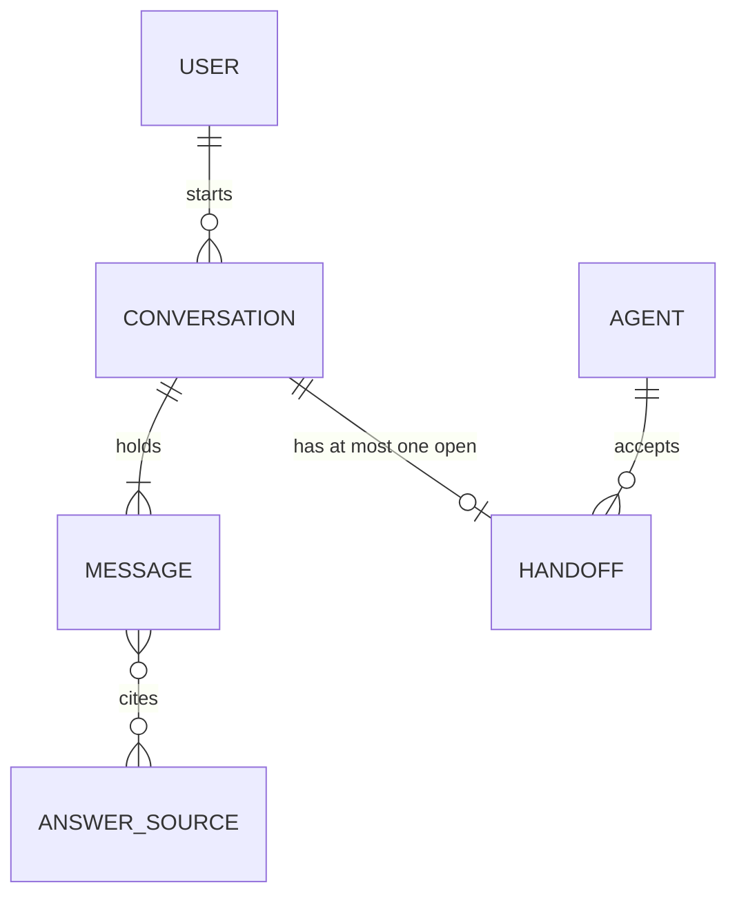
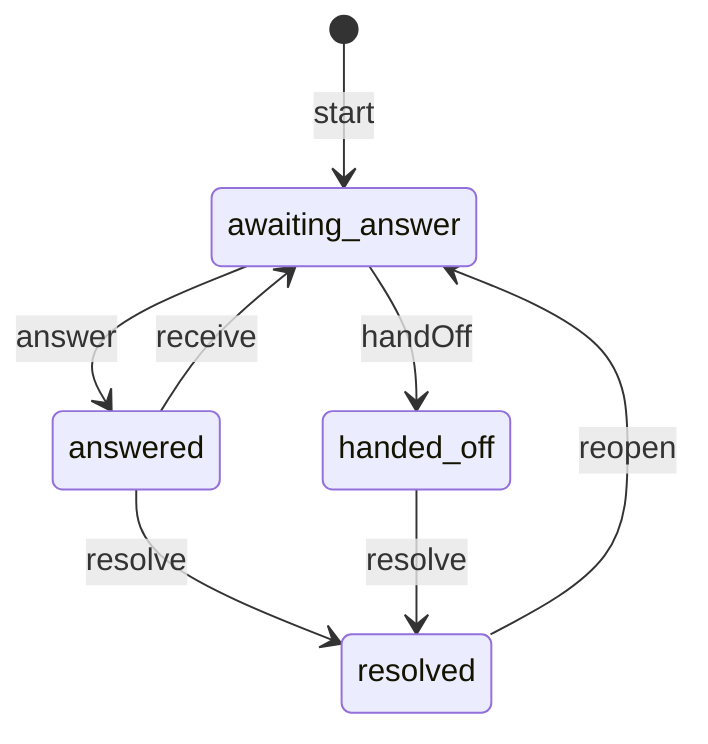
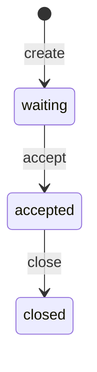

# Domain model: help desk bot

The words are the glossary's words, exactly. Each core object lists its behaviour and its rules before its fields.

## Entities and relationships

## Core objects

### Conversation
- Responsibility: keep one user's question thread consistent from the first message to resolve.
- Behaviour: `start(user, text)`, `receive(text)`, `answer(text, sources)`, `handOff(reason)`, `resolve(by)`, `reopen()`
- Invariants:
  - an answer cites at least one answer source (proved by `answer-without-source-refused`)
  - a resolved conversation takes no answer (proved by `answer-after-resolve-refused`)
  - at most one open handoff (proved by `second-handoff-refused`)
  - reopen only within 7 days of resolve (proved by `reopen-after-a-week-refused`)
- Emits: ConversationStarted, MessageReceived, Answered, HandedOff, Resolved, Reopened
- Lives in: `src/domain/conversation.ts`
- Lifecycle: the Conversation state machine below.
- Fields: id, userId, state, messages, handoff, resolvedAt

### Handoff
- Responsibility: move a conversation to a person and back, with the reason kept.
- Behaviour: `create(reason)`, `accept(agent)`, `close(note)`
- Invariants:
  - a reason is required (proved by `handoff-without-reason-refused`)
  - a closed handoff cannot be accepted (proved by `closed-handoff-cannot-be-accepted`)
- Emits: HandoffRequested, HandoffAccepted, HandoffClosed
- Lives in: `src/domain/handoff.ts`
- Lifecycle: the Handoff state machine below.
- Fields: id, conversationId, reason, state, agent, note

## State machines

### Conversation state machine
States: awaiting_answer, answered, handed_off, resolved

| From | To | Trigger | Guard | Effect | Journey |
|---|---|---|---|---|---|
| [*] | awaiting_answer | start | the first message is not empty | ConversationStarted | first-question-gets-answer |
| awaiting_answer | answered | answer | the answer cites at least one answer source | Answered | first-question-gets-answer |
| answered | awaiting_answer | receive | always | MessageReceived | follow-up-question |
| awaiting_answer | handed_off | handOff | a reason is given and no handoff is open | HandedOff | bot-hands-off-unknown |
| answered | resolved | resolve | the user confirmed | Resolved | user-confirms-resolved |
| handed_off | resolved | resolve | the handoff is closed | Resolved | agent-closes-handoff |
| resolved | awaiting_answer | reopen | within 7 days of resolve | Reopened | reopen-within-a-week |

### Handoff state machine
States: waiting, accepted, closed

| From | To | Trigger | Guard | Effect | Journey |
|---|---|---|---|---|---|
| [*] | waiting | create | a reason is given | HandoffRequested | bot-hands-off-unknown |
| waiting | accepted | accept | the handoff is waiting | HandoffAccepted | agent-closes-handoff |
| accepted | closed | close | a note is given | HandoffClosed | agent-closes-handoff |
