# Domain model: <product or bounded context>

The words are the glossary's words, exactly. The gate refuses: an entity or state not in `GLOSSARY.md`; a core
object with no behaviour or no invariant (a data bag); an invariant with no `proved by` journey; a core object with no
lifecycle line; a transition with no trigger or no guard (write `always` when there is no condition); a state named in
a transition that the object does not list; a diagram edge with no table row, or a row with no edge (the start edge
`[*] --> <state>` included); a transition that no journey in the spec's Objectives drives.

## Entities and relationships
```mermaid
erDiagram
  <ENTITY_A> ||--o{ <ENTITY_B> : <verb>
```
<Every entity is a glossary term (underscores read as spaces). Cardinality on every line.>

## Core objects

### <Object>
- Responsibility: <one reason to change, one line>
- Behaviour: `<method>(<args>)`, ... (method names the code will use)
- Invariants:
  - <rule the object enforces itself, never a caller> (proved by `<journey that tries to break it>`)
- Emits: <PastTenseEvent>, ...
- Lives in: `<module path>` (the secured check looks for each behaviour name there)
- Lifecycle: the <Object> state machine below. (or: `Lifecycle: none - <reason, e.g. a value that never changes>`)
- Fields: <name>, ... (last on purpose)

## State machines

```mermaid
stateDiagram-v2
  [*] --> <first state> : <creating behaviour>
  <from> --> <to> : <trigger>
```

### <Object> state machine
States: <state>, <state>, ...


| From | To | Trigger | Guard | Effect | Journey |
|---|---|---|---|---|---|
| [*] | <first state> | <creating behaviour> | <guard or always> | <Event> | <journey id> |
